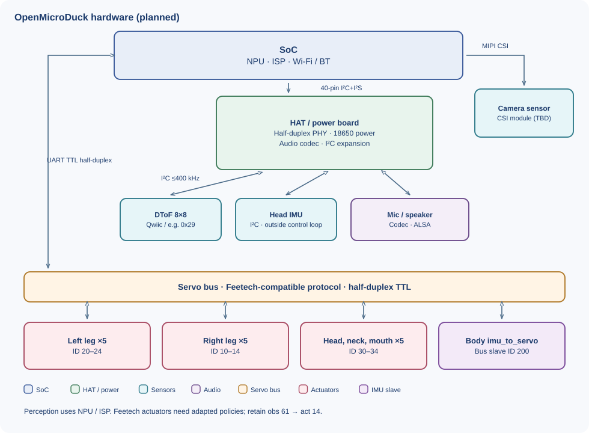

# Buduck

**A personal MicroDuck build for learning and fun, based on OpenMicroDuck.**

This fork uses English documentation and controls. Start with the [build documentation](docs/README.md), [printing guide](docs/structure.md), or [Motion Lab](motion-lab/README.md).

---

## What is this

OpenMicroDuck is a community reproduction of a bipedal robot platform: a 25 cm, sub-1 kg duckling with 15 degrees of freedom that walks, turns its head, makes sounds, and can run reinforcement-learning policies.

The hardware and software come from [JoyandAI/OpenMicroDuck](https://github.com/JoyandAI/OpenMicroDuck), based on MicroDuck from Pollen Robotics / Hugging Face. Upstream credit and license terms are in [NOTICE.md](NOTICE.md).

## Current progress

BAM actuator parameters for the Feetech HD-1910 follow the M6 parameters that Luwu Intelligence calibrated on the STS3215. They are already updated in the simulation RL project [microduck_rl](https://github.com/JoyandAI/microduck_rl/tree/develop/vendor/bam/bam/params/hd1910).

Base-model weights are released in the [policies](policies/) directory. The six ONNX files are deployable policies for the HD-1910. Observations are `[1,61]` and actions are `[1,14]`, with normalization baked into the graph. Deployment parameters and slot assignment are in [policies/README.md](policies/README.md).

| Model | File | What it does |
| --- | --- | --- |
| Walk | `OpenMD_walk.onnx` | Walks from a velocity command (`openmd_velocity`, iteration 9999). Used when the stick commands a nonzero speed. |
| Stand | `OpenMD_stand.onnx` | Stands when the commanded speed is zero (`openmd_velstand`, iteration 17500). |
| Ground pick | `OpenMD_ground_pick.onnx` | Bends down to pick something off the floor (iteration 3000; ankle gain 0.37 is baked into the graph). |
| Right kick | `OpenMD_kick_right.onnx` | Kicks with the right foot. Duration 0.5 s. |
| Roll | `OpenMD_roulade.onnx` | One forward roll. Duration 1 s. |
| Sit / stand | `OpenMD_sitstand.onnx` | Sit down and stand up; action scale is fixed at 1.0 in robotd 0.13.3. |

### Pre-deployment image

A system image for the Radxa Zero 3W, with the microduck runtime already installed, so you can skip setting up the environment.

Upstream image: [Radxa ZERO 3W runtime image](https://pan.baidu.com/s/15vAhpStkQ0C7q6i9n2H0tQ?pwd=7yzd). This upstream-hosted download may require an account; manual setup is covered in [the controller guide](docs/main_controller.md).

## BOM

Specs, quantities, version differences, and the structural-parts list are in **[docs/bom.md](docs/bom.md)**.

| Part | Model | Spec | Qty | Upstream reference price (CNY) and link |
| --- | --- | --- | --- | --- |
| Servo | **Feetech HD-1910-C001** | Constant-force coreless servo, 4–8.4 V, stall torque 12 kg·cm | 15 | [118](https://item.taobao.com/item.htm?id=1014620157895&mi_id=0000xBjtqiNSYJUq7QGMPpbYwmNEROqnEVZwYJWi5M4hP3Q&skuId=6133422044091&spm=a21n57.shop_search.0.0.18263d65wuqx4I) |
| Main board | **Radxa ZERO 3W** | RK3566, 2 GB RAM, Wi-Fi, no eMMC, pin-header version | 1 | [309](https://item.taobao.com/item.htm?id=763812025816&mi_id=0000uT5x0cTXxWeiB08JXVyTWI8UsD7hlB5D9f1engmhabY&spm=tbpc.boughtlist.suborder_itemtitle.1.2b562e8dNOWpmj&skuId=6066053424678) |
| SD card | MicroSD / TF | 64 GB, A1 or better | 1 | 60–100 |
| Zero Robot HAT | | AMP2.0 3P compatible, for Feetech HD-1910. Speaker and microphone connectors changed to XH-1.25 | 1 | [228](https://item.taobao.com/item.htm?abbucket=0&id=1090876838510&mi_id=0000ZS5hbUuCFijZNBh6Wm1foqfNFOfbMtdJPq5ofUGb8g8&ns=1&skuId=6311561534333&spm=a21xtw.29978516.product_shelf.11.7a1573ecGsriLO&xxc=taobaoSearch) |
| IMU-to-servo board | | LSM6DSV16X, AMP2.0-3P, power pass-through included | 1 | [158](https://item.taobao.com/item.htm?abbucket=0&id=1090873750118&mi_id=0000GbQT_tQe9YyNB1BGCyB_worUMn9XTHC7XOhnoTa6T74&ns=1&skuId=6311743311265&spm=a21xtw.29978516.product_shelf.12.7a1573ecGsriLO&xxc=taobaoSearch) |
| Camera | IMX219 with FPC cable | 8 MP | 1 | |
| Structure | PLA [+ TPU] FDM 3D print | Use TPU for the foot pads, or add a silicone pad under the sole, if you can | 1 | - |
| Bearing | 6700K | 10 × 15 × 3 | 3 | [2](https://item.taobao.com/item.htm?id=1084278550250&mi_id=0000IFo09JQwrF2qO5b7uhalH5jN7IxahG44rLmmvDEeCC8&skuId=6303412790720&spm=a21xtw.29978518.0.0&xxc=shop) |
| Bearing | ET2216 | 16 × 22 × 4 | 11 * | [3.5](https://item.taobao.com/item.htm?id=1084278550250&mi_id=0000IFo09JQwrF2qO5b7uhalH5jN7IxahG44rLmmvDEeCC8&skuId=6303412790721&spm=a21xtw.29978518.0.0&xxc=shop) |
| Fasteners | Screws | M2 self-tapping | as needed | |
| Microphones | | | 2 | |
| Speaker | 3525 cavity speaker | | 1 | |
| Battery | 7.4 V 3500 mAh 2S Li-ion pack | 18650, 2 in series, 2C, XH2.54 2P male | 1 | [48.9](https://item.taobao.com/item.htm?id=585852453584&mi_id=0000zeSmMUkUHskP6x88HRHh6m6PNRO0ZnSVYlrEaGHAW4g&spm=tbpc.boughtlist.suborder_itemtitle.1.34c22e8dbHwgTb) |

\* The ET2216 count of 11 is the joints that actually carry load and reduce friction. Another 10 joints have a bearing seat that does not support rotation or reduce friction. If you print the original Pollen parts and want the structure to match the original MicroDuck simulation, buy the full set of 14 bearings.

### Development extras

These are for bench debugging. They are not required on every robot.

| Part | Model | Spec | Qty | Reference price and link |
| --- | --- | --- | --- | --- |
| Servo driver | Waveshare serial-bus servo driver | Type-C | 1 | |
| Servo power adapter | 7.5 V servo adapter | 7.5 V 6 A, DC 5.5×2.1 plug | 1 | - |
| Main-board power adapter | USB-PD adapter | A Type-C PD adapter is enough; confirm 5 V at 2 A or more | 1 | - |
| Data cable | USB Type-C to Type-A, or Type-C to Type-C | 0.5–1.5 m | 1 | |
| Micro-HDMI cable | Micro-HDMI to HDMI | ~1.5 m | 1 | |
| Card reader | MicroSD reader | USB 2.0 is enough; skip this if the laptop already has one | 1 | |

## Architecture

The software follows the same loop as MicroDuck: offline PPO produces an ONNX, the board runs it at **50 Hz**, and the contract is **61-D observation → 14-D action**. The hardware uses alternative components documented by OpenMicroDuck. Changing the servo means retraining; the official ONNX is not a drop-in gait.



Part selection, servo wiring, processes, and the control loop are in **[docs/README.md](docs/README.md)** ([architecture](docs/architecture.md) · [main controller](docs/main_controller.md) · [servos](docs/servo.md)).

## Working on this fork

```bash
git clone https://github.com/tnmygrwl/buduck.git
cd buduck
cd motion-lab
./setup.sh
./run.sh
```

Open http://127.0.0.1:18765. Simulation runs on the CPU and does not need the motor kit.

For printing, open [cad/openmicroduck.3mf](cad/openmicroduck.3mf) in Bambu Studio.
Use [cad/openmicroduck-assembly-opt.stl](cad/openmicroduck-assembly-opt.stl) as the
assembly reference and [cad/parts/](cad/parts/) for individual parts. See the
[structural notes](docs/structure.md) before choosing battery and shell variants.

The upstream README and detailed BOM disagree on some quantities and ratings.
These differences are listed in [docs/bom.md](docs/bom.md#unresolved-upstream-differences);
verify them against the selected CAD and actual components before ordering.

## Licenses

| Content | License |
| --- | --- |
| Software | Apache-2.0 |
| Hardware and drawings derived from Microduck models | CC-BY-NC-SA-4.0 |

See [LICENSE](LICENSE) and [NOTICE.md](NOTICE.md). This replaces the conflicting license summary inherited from the upstream README; it does not relicense the project.

## Acknowledgements

This project is inspired by MicroDuck from Hugging Face / Pollen Robotics and reuses their publicly available training ecosystem. Once again, our thanks to the MicroDuck team for their pioneering work and open spirit — without them, this project would not exist. OpenMicroDuck is an independent community open-source project with no affiliation to Hugging Face or Pollen Robotics.
