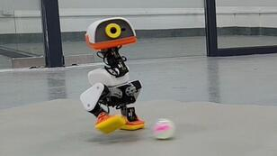
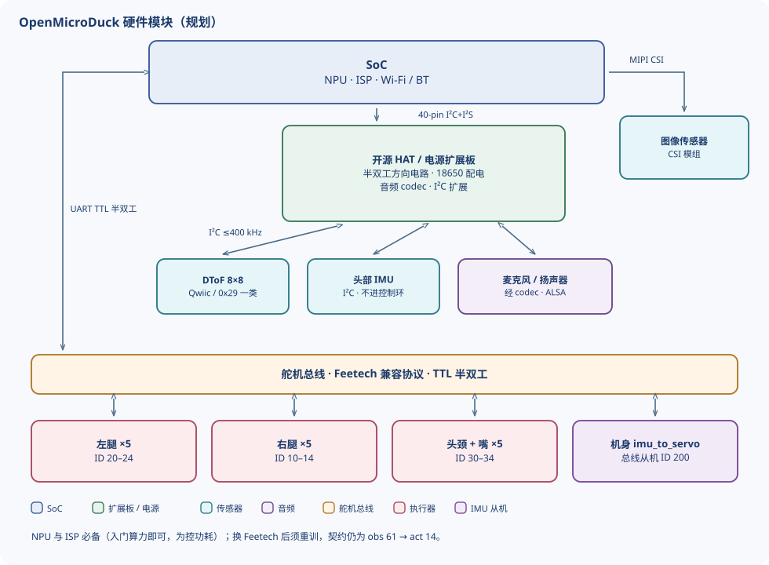

# OpenMicroDuck

**A fully open-source 25 cm bipedal robot duck**

[English](README_en.md) | [中文](README.md)

---

## What is this

OpenMicroDuck is a **fully open-source** bipedal robot platform: a 25 cm, sub-1 kg duckling with 15 degrees of freedom that walks, turns its head, makes sounds, and can run reinforcement-learning policies.

This project is **inspired by MicroDuck from Hugging Face / Pollen Robotics** — our thanks to them for bringing this little duck into the world and showing developers everywhere that a bipedal robot can be this lovable and within reach, and for openly sharing their training ecosystem so we can stand on their shoulders and keep going. Building on MicroDuck, we will publicly release the hardware drawings, PCB, BOM, software stack, and training environment from our reproduction process.

It is our practice of **technology democratization**, and our thanks to MicroDuck.

## Current progress

BAM actuator parameters for the Feetech HD-1910 follow the M6 parameters that Luwu Intelligence calibrated on the STS3215. They are already updated in the simulation RL project [microduck_rl](https://github.com/JoyandAI/microduck_rl/tree/develop/vendor/bam/bam/params/hd1910).

### Latest video

[OpenMicroDuck — National Day training results](https://www.bilibili.com/video/BV1hHHX6sEhS/)

The Feetech HD-1910 basic pipeline is working. More motions and smoother control are still being tuned.

Base-model weights are released in the [policies](policies/) directory. The five ONNX files are deployable policies for the HD-1910. Observations are `[1,61]` and actions are `[1,14]`, with normalization baked into the graph. Deployment parameters and slot assignment are in [policies/README.md](policies/README.md).

| Model | File | What it does |
| --- | --- | --- |
| Walk | `OpenMD_walk.onnx` | Walks from a velocity command (`openmd_velocity`, iteration 9999). Used when the stick commands a nonzero speed. |
| Stand | `OpenMD_stand.onnx` | Stands when the commanded speed is zero (`openmd_velstand`, iteration 17500). |
| Ground pick | `OpenMD_ground_pick.onnx` | Bends down to pick something off the floor (iteration 3000; ankle gain 0.37 is baked into the graph). |
| Right kick | `OpenMD_kick_right.onnx` | Kicks with the right foot. Duration 0.5 s. |
| Roll | `OpenMD_roulade.onnx` | One forward roll. Duration 1 s. |

### Pre-deployment image

A system image for the Radxa Zero 3W, with the microduck runtime already installed, so you can skip setting up the environment.

Image: [openmicroduck_joyandai.img.xz](https://pan.baidu.com/s/1fFFMAOTGGKsb7kdiIsmPMQ?pwd=i1dy)

## Community group

## BOM

Specs, quantities, version differences, and the structural-parts list are in **[docs/bom.md](docs/bom.md)**.

| Part | Model | Spec | Qty | Reference price and link |
| --- | --- | --- | --- | --- |
| Servo | **Feetech HD-1910-C001** | Constant-force coreless servo, 4–8.4 V, stall torque 12 kg·cm | 15 | [118](https://item.taobao.com/item.htm?id=1014620157895&mi_id=0000xBjtqiNSYJUq7QGMPpbYwmNEROqnEVZwYJWi5M4hP3Q&skuId=6133422044091&spm=a21n57.shop_search.0.0.18263d65wuqx4I) |
| Main board | **Radxa ZERO 3W** | RK3566, 2 GB RAM, Wi-Fi, no eMMC, pin-header version | 1 | [309](https://item.taobao.com/item.htm?id=763812025816&mi_id=0000uT5x0cTXxWeiB08JXVyTWI8UsD7hlB5D9f1engmhabY&spm=tbpc.boughtlist.suborder_itemtitle.1.2b562e8dNOWpmj&skuId=6066053424678) |
| SD card | MicroSD / TF | 64 GB, A1 or better | 1 | 60–100 |
| Zero Robot HAT | | AMP2.0 3P compatible, for Feetech HD-1910. Speaker and microphone connectors changed to XH-1.25 | 1 | [228](https://item.taobao.com/item.htm?abbucket=0&id=1090876838510&mi_id=0000ZS5hbUuCFijZNBh6Wm1foqfNFOfbMtdJPq5ofUGb8g8&ns=1&skuId=6311561534333&spm=a21xtw.29978516.product_shelf.11.7a1573ecGsriLO&xxc=taobaoSearch) |
| IMU-to-servo board | | LSM6DSV16X, AMP2.0-3P, power pass-through included | 1 | [158](https://item.taobao.com/item.htm?abbucket=0&id=1090873750118&mi_id=0000GbQT_tQe9YyNB1BGCyB_worUMn9XTHC7XOhnoTa6T74&ns=1&skuId=6311743311265&spm=a21xtw.29978516.product_shelf.12.7a1573ecGsriLO&xxc=taobaoSearch) |
| Camera | IMX219 with FPC cable | 8 MP | 1 | |
| Structure | PLA [+ TPU] FDM 3D print | Use TPU for the foot pads, or add a silicone pad under the sole, if you can | 1 | - |
| Bearing | 6700K | 10 × 15 × 3 | 3 | [2](https://item.taobao.com/item.htm?id=1084278550250&mi_id=0000IFo09JQwrF2qO5b7uhalH5jN7IxahG44rLmmvDEeCC8&skuId=6303412790720&spm=a21xtw.29978518.0.0&xxc=shop) |
| Bearing | ET2216 | 16 × 22 × 4 | 11 * | [3.5](https://item.taobao.com/item.htm?id=1084278550250&mi_id=0000IFo09JQwrF2qO5b7uhalH5jN7IxahG44rLmmvDEeCC8&skuId=6303412790721&spm=a21xtw.29978518.0.0&xxc=shop) |
| Fasteners | Screws | M2 self-tapping | as needed | |
| Microphones | | | 2 | |
| Speaker | 3525 cavity speaker | | 1 | |
| Battery | 7.4 V 3500 mAh 2S Li-ion pack | 18650, 2 in series, 2C, XH2.54 2P male | 1 | [48.9](https://item.taobao.com/item.htm?id=585852453584&mi_id=0000zeSmMUkUHskP6x88HRHh6m6PNRO0ZnSVYlrEaGHAW4g&spm=tbpc.boughtlist.suborder_itemtitle.1.34c22e8dbHwgTb) |

\* The ET2216 count of 11 is the joints that actually carry load and reduce friction. Another 10 joints have a bearing seat that does not support rotation or reduce friction. If you print the original Pollen parts and want the structure to match the original MicroDuck simulation, buy the full set of 14 bearings.

### Development extras

These are for bench debugging. They are not required on every robot.

| Part | Model | Spec | Qty | Reference price and link |
| --- | --- | --- | --- | --- |
| Servo driver | Waveshare serial-bus servo driver | Type-C | 1 | |
| Servo power adapter | 7.5 V servo adapter | 7.5 V 6 A, DC 5.5×2.1 plug | 1 | - |
| Main-board power adapter | USB-PD adapter | A Type-C PD adapter is enough; confirm 5 V at 2 A or more | 1 | - |
| Data cable | USB Type-C to Type-A, or Type-C to Type-C | 0.5–1.5 m | 1 | |
| Micro-HDMI cable | Micro-HDMI to HDMI | ~1.5 m | 1 | |
| Card reader | MicroSD reader | USB 2.0 is enough; skip this if the laptop already has one | 1 | |

## Architecture

The software follows the same loop as MicroDuck: offline PPO produces an ONNX, the board runs it at **50 Hz**, and the contract is **61-D observation → 14-D action**. The hardware is replaced with publicly fabricable domestic parts. Changing the servo means retraining; the official ONNX is not a drop-in gait.

Part selection, servo wiring, processes, and the control loop are in **[docs/README.md](docs/README.md)** ([architecture](docs/architecture.md) · [main controller](docs/main_controller.md) · [servos](docs/servo.md)).

## Roadmap

| Milestone | Date | Goal | Status |
| --- | --- | --- | --- |
| M1 | 2026-09 | Full assembly, RL walking check, desktop debug version frozen | Done |
| M2 | 2026-10 | Integrated robot frozen; bilingual tutorials published | Integrated robot done; tutorials being written |
| M3 | 2026-11 ~ | Production version; ecosystem growth: skill packs and ongoing compatibility work | Industrial design in progress |

An open-source project is not measured by small-batch unit counts, but by reproduction success rate and developer experience. Every milestone is reviewed in public; test data and issue lists are fully open.

## Get involved

Every level of contribution matters:

1. **Follow** — Star this repo, join the community (Discord / Bilibili / WeChat groups), follow the progress and spread the word
2. **Docs** — Write and translate bilingual tutorials
3. **Reproduce** — Print, assemble, file Issues on tolerances and interference; reproduction data is the hardest currency of open hardware
4. **Create** — Skill packs, appearance remixes, training-pipeline improvements
5. **Co-build** — Core-module PRs; join the maintainer committee and shape the technical direction together

See `CONTRIBUTING.md` (coming soon).

## Why we built it

**Lower the barrier.** The core technology of bipedal robots is not as distant as it seems — but imported servo kits costing thousands of yuan, closed-source structures, and scattered tutorials keep too many people out. We took every piece apart, validated it, and re-implemented it with an affordable domestic supply chain, then opened everything: a main board that only needs RK3566-class compute, a battery pack that is safe and removable, and structures you can make on a single 3D printer.

**Grow the ecosystem.** We hope more supply-chain partners will join in — servos, main boards, batteries, 3D-printing and injection-molded structures. The compatibility matrix is public; equivalent parts from any manufacturer can be adapted. Competition happens on open standards, and the whole ecosystem benefits.

**Spark more creativity.** What a duck can do should not be defined by us. Re-skin it, even change its form, write a new skill, tune a new gait, add a sensor — we look forward to more developer remixes, and to uses we could never imagine. What you create is not just a robot duck; it is the starting point of the next interesting, valuable product.

## Licenses

| Content | License |
| --- | --- |
| Hardware drawings, PCB, BOM | CERN-OHL-S |
| Software stack, training environment | Apache-2.0 |
| Tutorials & docs | CC BY-SA |

## Acknowledgements

This project is inspired by MicroDuck from Hugging Face / Pollen Robotics and reuses their publicly available training ecosystem. Once again, our thanks to the MicroDuck team for their pioneering work and open spirit — without them, this project would not exist. OpenMicroDuck is an independent community open-source project with no affiliation to Hugging Face or Pollen Robotics.
