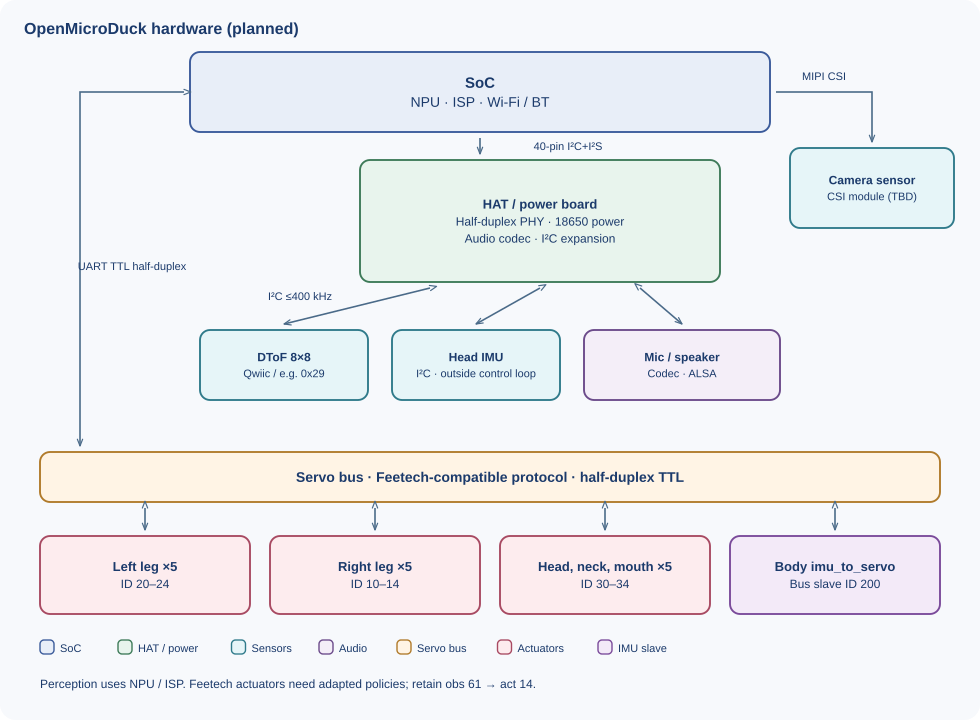
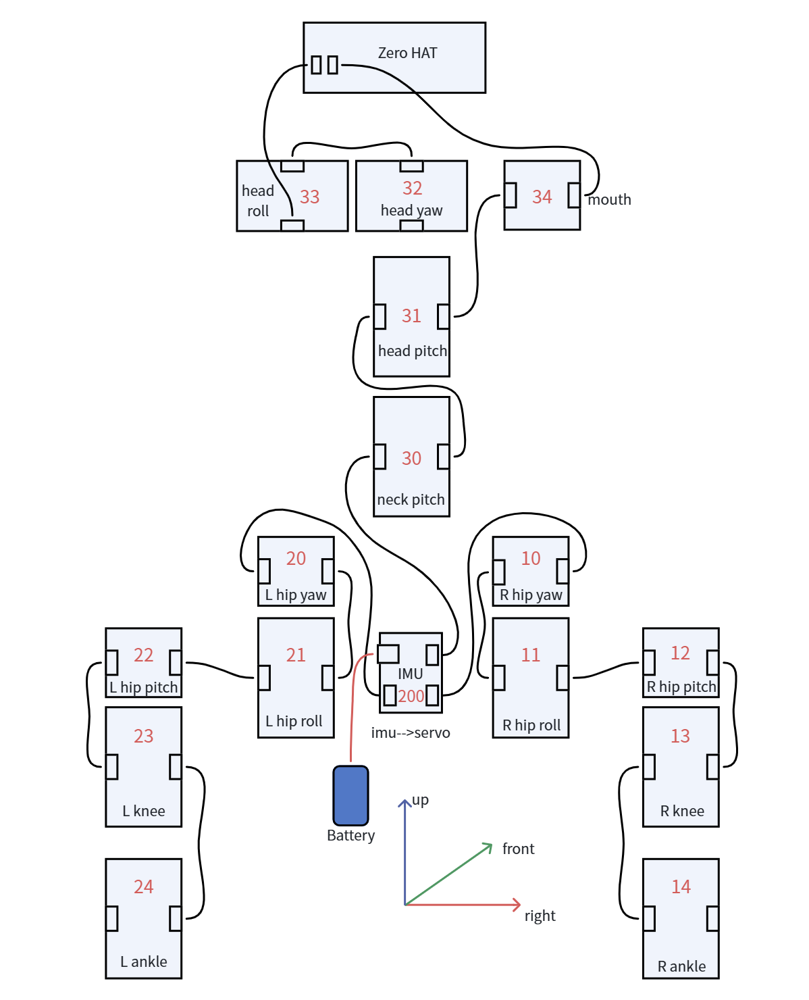

# Buduck build documentation

Buduck uses the OpenMicroDuck hardware and software as a learning project.
The current build uses **15 Feetech HD-1910-C001 servos** and a **URT-2** bench adapter.

| Topic | What to read |
|---|---|
| Print the chassis | [Printing and structural changes](structure.md) |
| Buy bearings, screws, and electronics | [BOM and unresolved discrepancies](bom.md) |
| Understand the software and wiring | [Architecture](architecture.md) |
| Choose and configure the onboard computer | [Main controller](main_controller.md) |
| Check servo specifications, pin order, and IDs | [Servos](servo.md) |
| Try the policies without hardware | [Motion Lab](../motion-lab/README.md) |
| Inspect the released HD-1910 models | [Policies](../policies/README.md) |
| Find upstream projects and technical sources | [References](reference.md) |

## Build sequence

1. Inventory the servos, cables, and URT-2. Confirm cable pin order and power requirements.
2. Configure one unmounted servo at a time, assign its joint ID, and verify feedback.
3. Test-print a servo mount, check the fit, then print the selected chassis parts.
4. Assemble and verify home positions, joint directions, and IMU orientation.
5. Bring up supported standing before walking.

The prearranged print project is [`cad/openmicroduck.3mf`](../cad/openmicroduck.3mf);
the individual parts are in [`cad/parts/`](../cad/parts/).
There are alternative shells and battery mounts: use the [printing guide](structure.md)
to distinguish them from the base part list.

## System overview

The training/deployment contract is **61 observations → 14 actions at 50 Hz**.
The mouth is the fifteenth servo and is controlled outside the locomotion policy.
Training uses MuJoCo / PPO offboard; onboard locomotion uses CPU ONNX Runtime.
Camera and ToF data feed higher-level behavior rather than the standard walking policy.

The documented controller is a **Radxa ZERO 3W**. The detailed BOM uses 2 GB RAM,
microSD, and fitted headers. Other controller options, including Pi Zero 2 W,
require compatibility work; see the [controller guide](main_controller.md).

## Joint IDs

| Group | ID → joint |
|---|---|
| Right leg | 10 → right_hip_yaw; 11 → right_hip_roll; 12 → right_hip_pitch; 13 → right_knee; 14 → right_ankle |
| Left leg | 20 → left_hip_yaw; 21 → left_hip_roll; 22 → left_hip_pitch; 23 → left_knee; 24 → left_ankle |
| Neck / head / mouth | 30 → neck_pitch; 31 → head_pitch; 32 → head_yaw; 33 → head_roll; 34 → mouth |
| Body IMU | 200 |

The HAT connects to mouth ID 34 and to the head chain
33 → 32 → 31 → 30. The neck connection branches to the left leg, right leg,
and body IMU. All share a half-duplex TTL bus; the target baud rate is **1 Mbps**.

**HD-1910 pin order differs from Dynamixel.** See [servo.md](servo.md) before wiring.

## Reading the inherited engineering notes

These guides translate the upstream snapshot; they are not a new hardware qualification.

| Evidence label | Meaning |
|---|---|
| Official | Vendor specifications or upstream software/design documentation |
| Source-derived | Inferred from device trees, code, register maps, or board scripts; not a production BOM |
| Planned | OpenMicroDuck design intent, not yet a validated compatibility matrix |
| Unresolved | Conflicting documentation or unspecified production parts |

Check the detailed guide for each interface. Current source and the actual
hardware take precedence over historical prices and planning notes.
