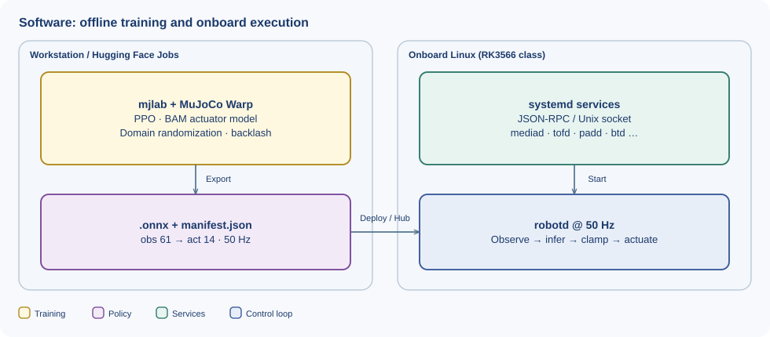
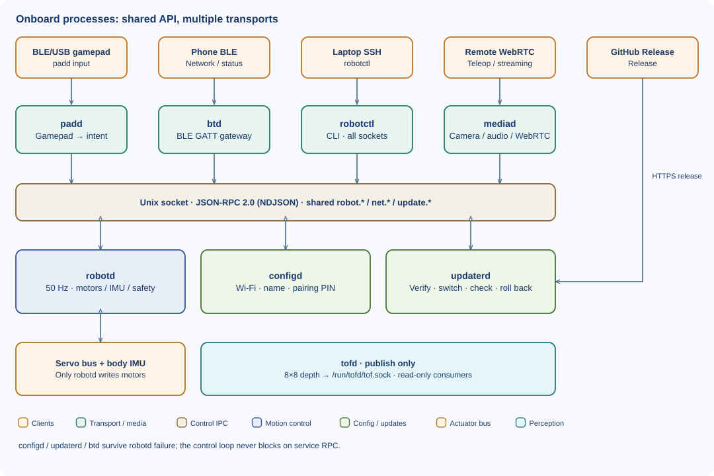
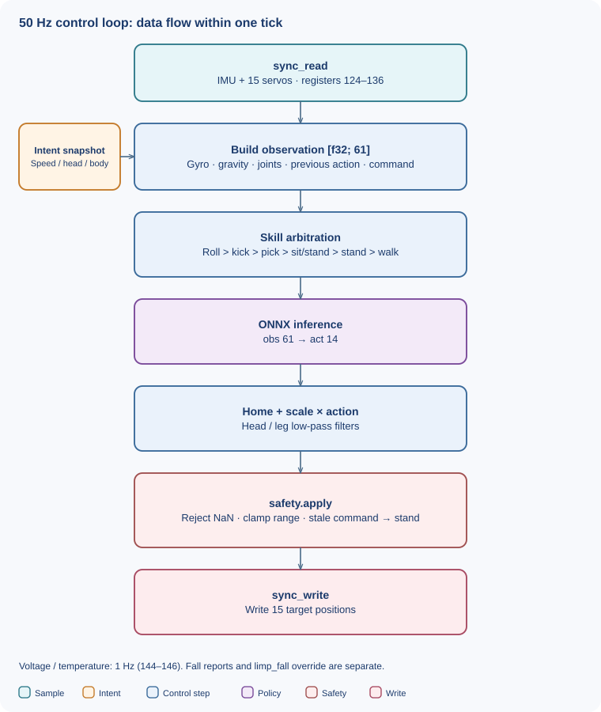
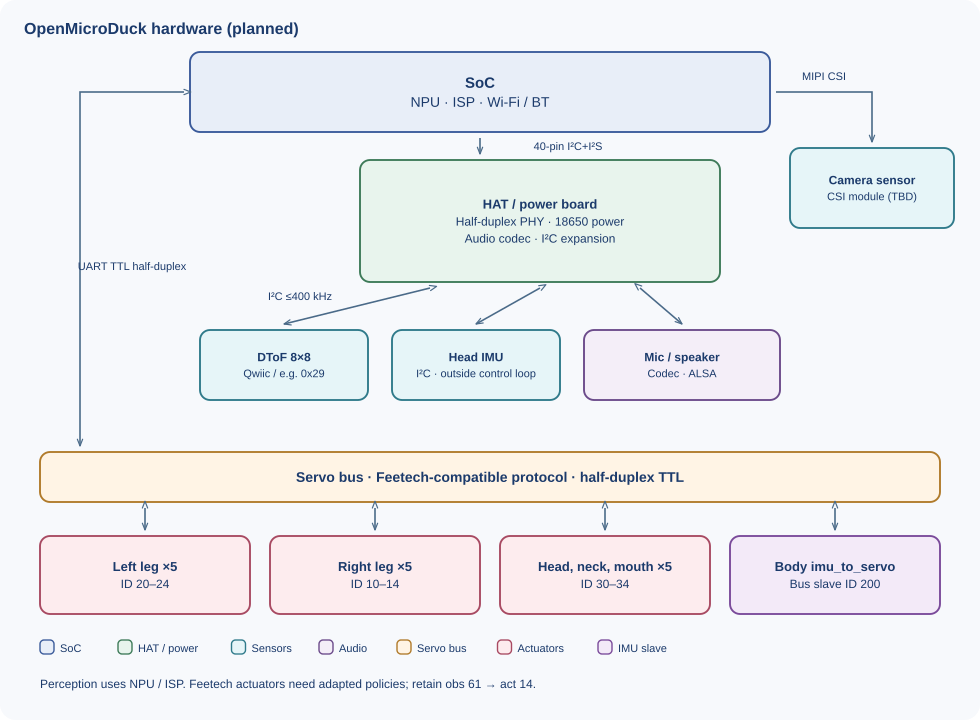
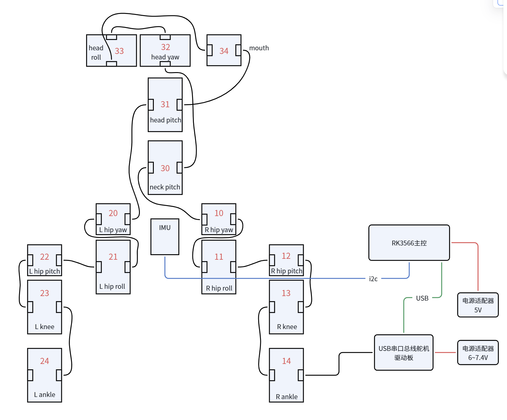
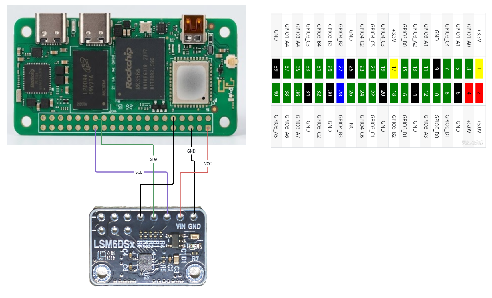
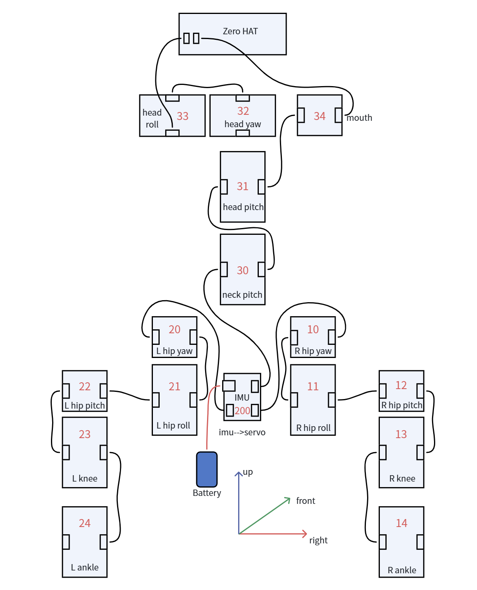
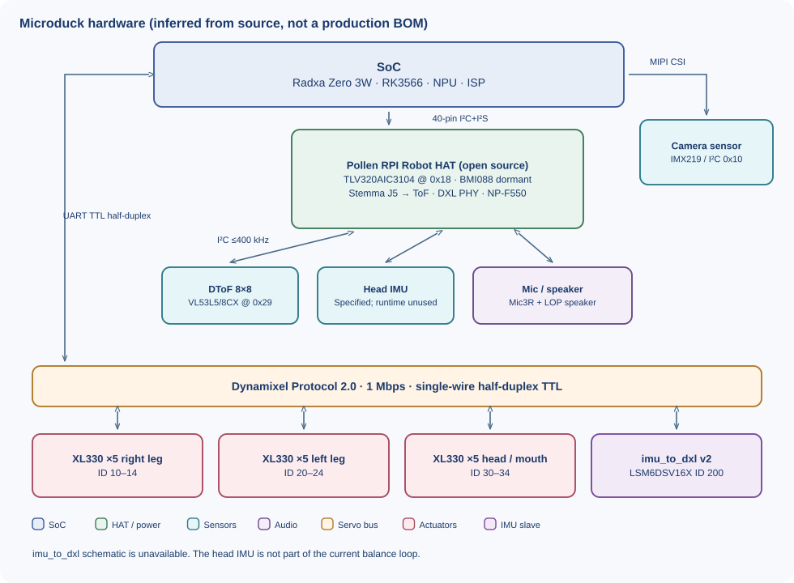

# OpenMicroDuck / Microduck architecture

This guide describes the inherited training, deployment, sensing, and actuator
architecture. The software follows the same sim-to-real loop: train offboard,
export ONNX, and execute a closed loop onboard at 50 Hz. Hardware selection,
power, and public design availability differ.

| Evidence label | Meaning |
|---|---|
| Official | Product information or Pollen runtime / training source and design documents |
| Source-derived | Reconstruction from device paths, I²C addresses, and registers; not a production BOM |
| Planned | OpenMicroDuck design intent |
| Unresolved | Conflicting sources or parts not yet finalized |

Sources are indexed in [reference.md](reference.md). These are translated
engineering notes from the imported snapshot, not a fresh audit of upstream.
For licensing, use [LICENSE](../LICENSE) and [NOTICE.md](../NOTICE.md); earlier
planning text mentioning CERN-OHL-S does not replace the included licenses.

## 1. Software

The pipeline accepts behavioral intent and applies safety limits before issuing
motor targets. Camera images and 8×8 ToF matrices do **not** enter the standard
walking policy; perception publishes small features to higher-level behavior.

### 1.1 Training

[`microduck_rl`](https://github.com/pollen-robotics/microduck_rl) uses
**mjlab / MuJoCo Warp + PPO**. Training runs offboard with CUDA; Hugging Face Jobs
is an alternative to a local GPU. Community ports target other compute stacks.

Actuator modeling is central to sim-to-real transfer:

- **BAM M6:** XL330 voltage control, back EMF, Coulomb/Stribeck friction, and load-dependent friction.
- **Domain randomization:** battery voltage, load-induced voltage drop, command delay, and friction.
- **Backlash variants:** ±1° gear play at each joint, with observations taken on the encoder side after the play.

Walking, standing, sit/stand, pickup, kicking, rolling, and skating are separate
tasks with a shared observation width. The browser sandbox uses MuJoCo WASM and
onnxruntime-web at 50 Hz for policy playback; it does not replace training.

### 1.2 Policy contract

Use the exported **ONNX**, with observation normalization embedded in the graph.
Do not replace it with an ad hoc checkpoint conversion.

| Interface | Size | Contents |
|---|---|---|
| Observation | 61 | gyro (3), projected gravity (3), joint position (14), joint velocity (14), previous action (14), command (13) |
| Action | 14 | Policy-controlled joint targets; excludes the mouth |
| Control rate | 50 Hz | One policy inference per tick |

The 13 command values contain velocity `vx, vy, vyaw` (3), head targets (4),
and body pose (6). Body x/y/yaw are unbound in the described training setup and
nominally zero.

The mouth is the fifteenth axis. Higher-level behavior handles opening, pickup,
chorus, and theremin actions; its policy expansion slot remains zero.

Published policy packages contain an ONNX file and `manifest.json`, describing
dimensions, `model_api`, and robot compatibility. Official components, community
Hub packages, and local paths populate the same runtime policy slots.

Vision uses a separate model family: an INT8 `.rknn` detector, such as YOLO11n
at 320×320, intended for the RK3566 NPU inside `mediad`. At the documented snapshot,
the training repository was inaccessible and the complete camera-to-behavior
integration was unfinished. Audio calls are synthesized from a deterministic
SoC-serial-number seed rather than TTS.

### 1.3 Execution

`robotd` loads ONNX Runtime dynamically and runs locomotion inference on the CPU.
ORT is a board dependency rather than part of the runtime release archive.

| Workload | Owner | Execution |
|---|---|---|
| Locomotion ONNX | `robotd` | CPU / ONNX Runtime |
| Duck detector RKNN | Intended for `mediad` | 0.8 TOPS NPU |
| Microphone pet detection, approximately 20 KB CNN, 40-band log-mel | `robotd` worker | CPU |

The control loop consumes small last-value feature snapshots at approximately
10–30 Hz, not RGB frames. Blocking image work remains outside the balance loop.

### 1.4 Processes and communication

Seven daemons and one CLI use **JSON-RPC 2.0 over Unix sockets**, serialized as
NDJSON. `systemd` manages their lifecycle.

| Process | Responsibility | Endpoint | External interface |
|---|---|---|---|
| `robotd` | Motors, body IMU, policies, safety, health | `/run/robotd.sock` | Servo bus |
| `configd` | Wi-Fi, name, pairing PIN, gamepad pairing | `/run/configd.sock` | BlueZ / NetworkManager D-Bus |
| `updaterd` | Signature checks, atomic update, rollback | `/run/updaterd.sock` | GitHub, systemctl, robot.health |
| `btd` | Stateless BLE gateway | GATT | Forwards to robotd/configd/updaterd |
| `padd` | Gamepad input to intent | `/run/padd/pad.sock` | robotd |
| `mediad` | Camera, microphone, encoding, WebRTC, remote gateway | TCP 8080 / 8443 | Service forwarding and media |
| `tofd` | Head ToF | `/run/tofd/tof.sock` | HAT I²C |
| `robotctl` | CLI | — | All service sockets |

1. **Only robotd writes motors.** Clients request intent; the safety layer decides what can execute.
2. **configd, updaterd, and btd survive robotd failure**, preserving recovery access.
3. **The control loop never performs synchronous RPC** to another service.
4. Control messages use sockets; high-volume frame transfer, if needed, uses shared memory / dmabuf.

The same API is exposed through a BLE subset, Unix sockets, WebSocket, and WebRTC
data channels. The WebRTC `control` channel is reliable/ordered; `teleop` is
unreliable/unordered so stale stick commands are not retransmitted. LLM clients
request individual JPEGs rather than a continuous 30 fps stream.

### 1.5 One control tick

At 50 Hz, one bus read gathers servo and IMU state; observation construction and
skill arbitration select the policy; inference produces 14 actions; home offsets,
scaling, filtering, and safety produce 15 servo targets for the bus write.

The upstream Dynamixel layout reads registers 124–136 for fast feedback and
144–146 for voltage/temperature at 1 Hz. Feetech drivers must map their own registers.

Supply voltage is averaged across the 15 servo reports; there is no fuel gauge.
Temperature is reported per joint, including the hottest joint's name.

Fall reporting uses projected gravity and debounce. Separately, `limp_fall`
predicts impact from gyro data, temporarily takes over the joints, releases effort,
and hands back to standing. A fall does not itself prohibit enable/skill calls.

### 1.6 Sensors

| Data | Reader | Rate | In the locomotion observation? |
|---|---|---|---|
| Servo position / velocity / PWM / current | robotd sync_read | 50 Hz | Position and velocity of 14 joints; other feedback supports diagnostics/control |
| Body gyro + SFLP quaternion | Same bus read, ID 200 | 50 Hz | Gyro and projected gravity |
| Servo voltage / temperature | robotd slow read | 1 Hz | No; optional voltage adaptation is separate |
| 8×8 ToF | tofd socket | About 15 Hz | No; theremin, avoidance, and behavior |
| Camera | mediad, ISP + MPP H.264 | Default 720p30 | No; detection features only |
| Microphone | Codec / ALSA; mediad and pet-detect | Audio rate | No |
| Head IMU | Mentioned in product specification | Unspecified | Not used by the current balance loop |
| SoC temperature | robotd / sysfs | 1 Hz | No |

Odometry combines foot contacts with IMU heading. There is no magnetometer;
heading drifts and should be treated as relative motion.

### 1.7 Sound

1. `sounds ensure-bank` builds a per-robot call bank using a SoC-derived seed.
2. `sound.rs` launches `aplay`; a new sound replaces the previous playback.
3. ALSA uses `plughw:aic3104` on the documented development setup. Speakers use codec LEFT_LOP / RIGHT_LOP.
4. Chorus elects the lowest BLE beacon ID as conductor. `btd` transports beacons; motion decisions stay elsewhere. Chorus is off by default because it moves the mouth and head.
5. Theremin behavior maps ToF depth to pitch and mouth opening without blocking the 50 Hz loop.

WebRTC can carry bidirectional audio. Remote audio and local calls compete for
the same PCM device.

## 2. Hardware

Both designs use an RK3566-class Linux computer, a power/audio/I²C expansion
board, one half-duplex servo bus, and head-mounted camera/ToF peripherals.

### 2.1 OpenMicroDuck plan

| Item | Planned design |
|---|---|
| Envelope | 25 cm; up to 1 kg |
| Degrees of freedom | 15: two 5-axis legs, four head/neck axes, one mouth |
| Servos | 15 Feetech-compatible TTL bus actuators with feedback; current build HD-1910-C001 |
| Compute | RK3566 class; current documented board Radxa ZERO 3W |
| Power | Removable 18650/21700 pack; current HD-1910 build uses 2S 7.4 V nominal |
| Structure | Printed parts; early planning also considered sheet metal |
| Control | 50 Hz onboard, offboard MuJoCo/PPO training |

Early plans mention 3S / 12 V variants. **Those are not a direct supply option for
the 4–8.4 V HD-1910.** Match the servo rail to the actual actuator.

| Module | Interface | Notes |
|---|---|---|
| SBC | Header, CSI, UART, USB-C | Must sustain 50 Hz ORT plus bus and safety work |
| HD-1910 servos | Three-wire TTL | Vendor protocol and pin order; see [servo guide](servo.md) |
| Body `imu_to_servo` | Servo bus, planned ID 200 at 1 Mbps | MCU + LSM6DSV16X SFLP + half-duplex PHY; emulate the required IMU register block |
| Head IMU | 3.3 V I²C, up to 400 kHz | Outside the balance loop; check shared addresses |
| Camera | MIPI CSI-2 + control I²C | IMX219 / 160° lens in planning; final module not fixed |
| 8×8 DToF | 3.3 V Qwiic/Stemma I²C, commonly 0x29 | VL53L5CX/L8CX family; tofd publishes the matrix |
| Microphone | Codec input; I²C control / I²S data | Exact part depends on HAT revision |
| Speaker | Codec line-out / amplifier | 3525 in the root BOM |
| Battery | HAT power distribution | Charging, undervoltage protection, and servo rail need explicit design |

Joint IDs are listed in [docs/README.md](README.md#joint-ids).

The HAT needs half-duplex direction control, battery distribution, and I²C/I²S.
[Pollen's RPI Robot HAT](https://github.com/pollen-robotics/elec_RPI_Robot_HAT)
supports Dynamixel or Feetech electrically, subject to cable pin order.
This does not imply wire-protocol compatibility.

When registers, baud rates, or actuator dynamics differ, adapt the `RobotIo`
driver and validate/retrain using the correct BAM or measured actuator model.

### 2.2 Microduck reconstructed from public source

The product description cited by upstream gives 25 cm height, 14 cm width,
under 800 g, 15 DoF, 50 Hz, NP-F550 2600 mAh, Wi-Fi/Bluetooth, and two NFC antennas
(head and beak). Detailed component identification below is **source-derived**,
not a confirmed retail teardown.

| Module | Source-derived identification | Interface / qualification |
|---|---|---|
| Compute | RK3566, Cortex-A55, Mali-G52, 0.8 TOPS NPU | Device tree targets `radxa,zero-3w`; product specification 1 GB / 32 GB |
| Servos | Dynamixel XL330, M288-T used as the comparison baseline | Protocol 2.0, 1 Mbps, TTL |
| Bus PHY | On HAT | UART TX/RX to single wire; automatic direction switching, no runtime direction GPIO |
| Body IMU | LSM6DSV16X on `imu_to_dxl` v2 | ID 200, 12-byte read at address 124; schematic unavailable in the documented snapshot |
| HAT IMU | BMI088 | I²C 0x19 / 0x68; marked dormant/unused |
| Head IMU | Product specification only | No current balance-loop use; exact implementation unresolved |
| Camera | IMX219 / Pi Camera v2 path | CSI + I²C 0x10; 1080p30 sensor, ISP scales to 720p30; final lens unresolved |
| DToF | VL53L5CX or VL53L8CX | HAT Stemma J5, 0x29; about 90 KB firmware upload on startup |
| Audio codec | TLV320AIC3104 | I²C 0x18 + I²S3, 12 MHz MCLK; ALSA `aic3104` |
| Microphone | HAT MEMS via Mic3R | Exact part unspecified |
| Speaker | Codec LOP | Exact part unspecified |
| NFC | Head and beak antennas | Controller/interface unspecified |
| Battery | NP-F550, 2S, nominal 7.2 V | Voltage inferred from servo bus; how this is reconciled with retail XL330's 6 V maximum was unresolved |

The IMU block contains gyro x/y/z as little-endian i16 in bytes 0–5 (±500 dps),
then SFLP quaternion x/y/z as binary16 in bytes 6–11.
The host reconstructs `w = sqrt(1 - x² - y² - z²)`; it does not run sensor fusion.

I²C3 M0 uses header pins 3/5. Switching from the vendor's M1 assignment for
FUSB302 USB-C PD removes PD negotiation; ordinary 5 V input remains available.
Armbian's UART2 serial-getty must not occupy the servo bus.

The advertised two IMUs do not imply two IMUs in the policy observation.
The active balance path uses the bus-mounted LSM6DSV16X; the HAT BMI088 is dormant.

### 2.3 Public hardware boundary

| Published in the documented upstream snapshot | Not published as complete open hardware |
|---|---|
| Apache-2.0 runtime and training software | Editable production mechanical CAD and complete assembly guide |
| ONNX policies, simulation MJCF and STL | imu_to_dxl schematic |
| RPI Robot HAT KiCad, Gerber, BOM | Production BOM, harness drawings, NFC controller, some final sensor part numbers |

Simulation meshes retain their own noncommercial ShareAlike license.

## 3. Comparison

| Area | OpenMicroDuck | Microduck reference |
|---|---|---|
| Software contract | PPO → ONNX → 50 Hz robotd | Same architecture |
| Compute | RK3566-class, currently ZERO 3W | RK3566; source targets ZERO 3W |
| Actuators | Feetech HD-1910 | Dynamixel XL330 |
| Body IMU | imu_to_servo, ID 200 behavior | imu_to_dxl |
| Head IMU | Auxiliary I²C, outside balance loop | Specified but not used by current loop |
| Camera / ToF | CSI + I²C 8×8 | IMX219 + VL53L5/8CX source paths |
| Battery | 18650/21700 pack | NP-F550 |

Changes to actuators or mass distribution require policy validation and often
retraining. Keep the **61 → 14** contract when adding skills.

## 4. Sources

- [Runtime architecture](https://github.com/pollen-robotics/microduck/blob/main/docs/design/architecture.md)
- [Control loop and bus](https://github.com/pollen-robotics/microduck/blob/main/docs/design/robotd-design.md)
- [Policy channel](https://github.com/pollen-robotics/microduck/blob/main/docs/design/policy-channel-design.md)
- [Training](https://github.com/pollen-robotics/microduck_rl)
- [HAT](https://github.com/pollen-robotics/elec_RPI_Robot_HAT)
- [Product specification](https://pollen-robotics.com/microduck/press-kit/)
- [Reference index](reference.md)

