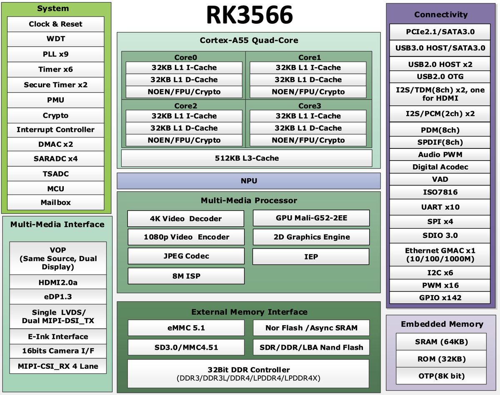
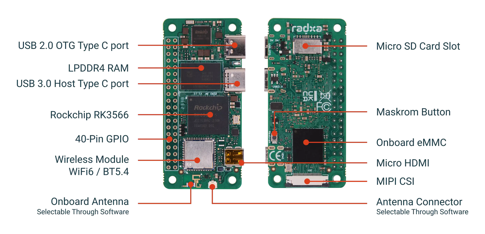
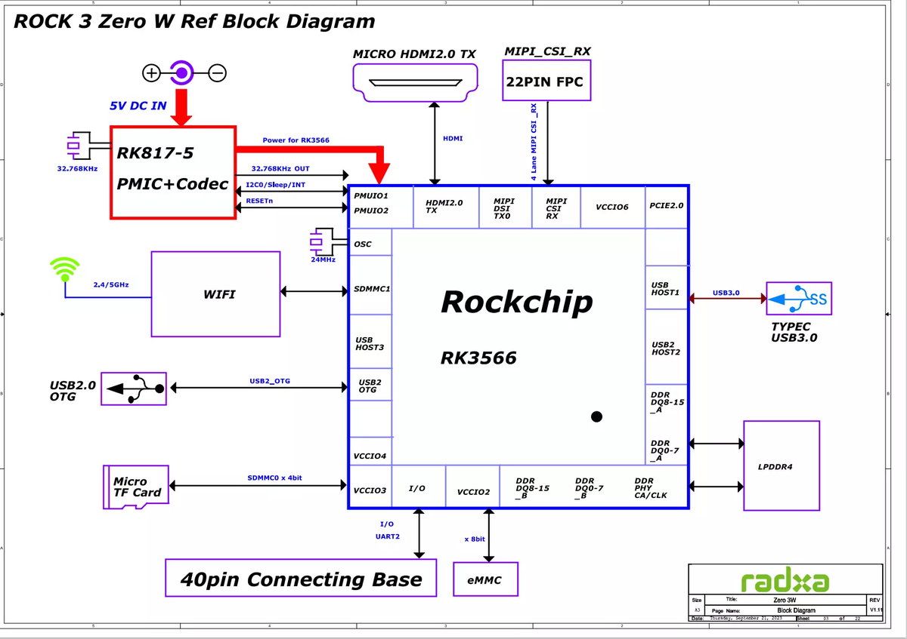

# Main controller selection

This guide translates the upstream controller comparison. It distinguishes
vendor specifications, source-derived details, design plans, and unresolved
items using the [architecture guide's evidence labels](architecture.md).
It is not a newly measured compatibility matrix.

## 1. Current choice and acceptance criteria

**Radxa ZERO 3W is the documented starting point.** It has the smallest gap from
the upstream device tree, overlays, HAT wiring, NPU scripts, and runtime.
The detailed BOM uses 2 GB RAM, microSD, and fitted headers; upstream product
notes also describe a 1 GB / 32 GB eMMC configuration.

| Priority | Candidate | Tradeoff |
|---|---|---|
| 1 | ZERO 3W, at least 1 GB; eMMC when appropriate | Closest to the reference stack |
| 2 | Other RK3566 Zero boards or CM4-style modules such as Radxa CM3 | Similar NPU/camera stack; carrier and pins still need checking |
| 3 | RK3568 development board | Useful bench platform before reducing size |
| 4 | SpacemiT K1 | RISC-V port, power, and thermal work required |
| 5 | Pi Zero 2 W / Pi CM4 | Familiar hardware; different memory and AI acceleration limits |

Fit and compute are separate requirements. Zero-size boards are about 65×30 mm;
CM4-style modules about 55×40 mm. A custom carrier can replace the HAT, but matching
connectors does not guarantee matching UART, I²C, I²S, or CSI pin assignments.

Acceptance checks:

1. Sustain ONNX Runtime inference at **50 Hz**, leaving CPU time for bus I/O and safety.
2. Expose **3.3 V UART + I²C + I²S** concurrently.
3. Provide working CSI, or explicitly adapt `mediad` for a USB camera.

The upstream vision plan calls for onboard AI acceleration. **Locomotion itself
uses CPU ONNX Runtime and does not require an NPU.** A different vision stack
needs its own performance validation.

## 2. Reference Microduck target

The cited product specification names RK3566 with an AI accelerator, **1 GB RAM /
32 GB storage**, without a board vendor. Source and device trees target
**Radxa ZERO 3W**, Armbian, and Debian Trixie user space:
`compatible = "radxa,zero-3w"`.

This is a software target, not confirmation that every production revision uses
the same retail board. See [updater design](https://github.com/pollen-robotics/microduck/blob/main/docs/design/updater-design.md).

## 3. RK3566

Image source: [Radxa ZERO 3 documentation](https://docs.radxa.com/zero/zero3).

| Feature | Chip / documented board values |
|---|---|
| CPU | Four Cortex-A55; 32 KB instruction + 32 KB data L1 per core; shared 512 KB L3 |
| Clock | ZERO 3W up to 1.6 GHz; chip-level descriptions may quote 1.8 GHz |
| GPU | Mali-G52 1-Core-2EE; OpenGL ES 3.2, Vulkan 1.1, OpenCL 2.0 |
| NPU | One core, up to 0.8 TOPS; INT8 / INT16 convolution; RKNN |
| Memory | 32-bit DDR3/DDR4/LPDDR3/LPDDR4/LPDDR4X controller; ZERO 3W 1–8 GB LPDDR4 |
| Video | 4K60 H.264/H.265/VP9 decode; 1080p H.264/H.265 encode |
| Camera | Four-lane MIPI CSI + approximately 8 MP ISP; board exposes 22-pin CSI |
| I/O | USB 3.0, GbE MAC, PCIe 2.1 ×1, UART/I²C/I²S/PWM; not all are exposed on each board |

For this robot, CPU handles the 61-value observation and 50 Hz inference;
CSI/ISP/MPP serve the camera stream; NPU serves planned perception;
UART/I²S/I²C serve the HAT.

## 4. ZERO 3W interfaces

Images: [Radxa documentation](https://docs.radxa.com/zero/zero3);
the upstream diagram is labeled V1.11.

| Item | Documented specification |
|---|---|
| Size | 65 × 30 mm; Pi Zero-style mounting |
| CPU | RK3566, four A55, up to 1.6 GHz |
| RAM | 1 / 2 / 4 / 8 GB LPDDR4 |
| Storage | Optional 8–64 GB eMMC and microSD |
| Wireless | Wi-Fi 6 + Bluetooth 5.4 BLE; onboard antenna or U.FL |
| USB | USB 2.0 Type-C OTG for power/flashing; USB 3.0 Type-C host |
| Display | Micro-HDMI, up to 1080p60 |
| Camera | 22-pin, 0.5 mm pitch, four-lane CSI |
| Expansion | 40-pin, 3.3 V GPIO, UART/SPI/I²C/I²S/PWM |
| Power | 5 V / 2 A via OTG in the board specification |
| PMIC | RK817 with onboard codec |

Robot-specific routing:

- **UART2:** header → half-duplex HAT → servos and body IMU. Disable/mask the serial-getty assigned to this UART before using it for the bus.
- **I²C3 M0:** header pins 3/5 → codec and ToF. The reference overlay switches this controller away from M1 / FUSB302 USB-C PD, removing PD negotiation.
- **CSI:** IMX219 path to mediad.
- **I²S:** HAT TLV320AIC3104.
- **Wi-Fi / Bluetooth:** configd / btd, independent of the HAT.

ZERO 3E uses Ethernet instead of onboard wireless. It requires additional
Wi-Fi/Bluetooth hardware for the documented wireless workflows.

## 5. CPU policies and the NPU

### Locomotion

The reference runtime loads **ONNX** through CPU ONNX Runtime. The cited
`Cargo.toml` records ORT floor 1.23 / target 1.28.0; `policy::ensure_runtime`
checks for the dynamic library before starting inference. The upstream policy
Hub snapshot contained nine ONNX models, not RKNN files. Buduck's **HD-1910**
policy directory contains six separate adapted models.

The web simulator uses onnxruntime-web at the same 50 Hz contract.

### Detector status in the inherited snapshot

The NPU bring-up notes describe `duck-detect` dynamically loading
`librknnrt.so`, with RKNN runtime 2.3.2. Perception is intended to run near the
camera in mediad and publish features to robotd.

At that snapshot, the complete camera → detector → behavior path remained
unfinished. `duck-bench` was a separate benchmark copied to the board, not a
shipping behavior service. A raw NV12 tee existed, but the needed frame IPC path
was absent. The training repository was inaccessible and matching public RKNN
weights/datasets were not available to independently reproduce the training metrics.

Armbian left `npu@fde40000` disabled. The release preinstall hook invokes
`setup-npu.sh` to install an overlay; a **reboot** is needed to bind the driver.
Earlier packaging had included the script without calling it.

### Reported benchmark, not a new measurement

The cited bring-up document describes one ZERO 3, 2 Hz, 30 frames, three passes.

| Metric | Reported value | Qualification |
|---|---|---|
| Driver / runtime | 0.9.8 / 2.3.2 | Runtime agrees with cited Cargo metadata |
| Latency p50 / p95 | 25.7 / 58.4 ms | Inference + decode; excludes JPEG |
| Process CPU per frame | 20.7 ms | Includes CPU letterboxing 1280×720 → 320×320; NPU cost not isolated |
| SoC temperature | 63 °C | End-of-run reading |
| Detection count | Not supplied in table | Compared against manually annotated frames |

Model description: YOLO11n, 320×320, one class, about 3.9 MB INT8,
reported held-out mAP50 0.976. These are upstream self-reported results,
not independently reproducible measurements from this fork.

A separate approximately 20 KB `pet-detect` CNN uses microphone 40-band log-mel
features in its own **CPU worker**, unrelated to RKNN.

## 6. Small-board alternatives

### Zero-size SBCs

| Board | CPU | RAM | AI accelerator | CSI | Wireless |
|---|---|---|---|---|---|
| Radxa ZERO 3W | 4× A55, 1.6 GHz | 1–8 GB | 0.8 TOPS RKNN | Yes | Wi-Fi 6 / BT 5.4 |
| Pi Zero 2 W | 4× A53, 1 GHz | 512 MB | None | Yes | Wi-Fi 4 / BT 4.2 |
| Orange Pi Zero 2W | H618, 4× A53, 1.5 GHz | 1–4 GB | None | No; 24-pin expansion FPC instead | Wi-Fi 5 / BT 5.0 |
| BPI-M4 Zero | H618, 4× A53, 1.5 GHz | 2 / 4 GB | None | No; 24-pin expansion FPC | Wi-Fi 4/5 / BT 5.0 |

Pi Zero 2 W appeared in earlier runtimes and related robots, including
[Rhoban microban](https://github.com/Rhoban/microban). Its 512 MB RAM and slower
CPU make simultaneous ORT and media work a separate validation task; RKNN is
unavailable. It remains useful for servo communication experiments.

H618 boards fit similar envelopes but lack the documented CSI/RKNN paths.
Other RK3566 Zero boards, such as Geniatech XPI-3566-ZERO, need individual pin
and device-tree checks.

### CM4-style modules

A carrier board can combine half-duplex servo hardware, codec, ToF, battery
distribution, and CSI. Mechanical compatibility with dual 100-pin CM4 connectors
does not establish complete electrical or software compatibility.

| Module | SoC | Implications |
|---|---|---|
| Raspberry Pi CM4 | BCM2711, 4× A72 | More CPU capacity; no RKNN; optional wireless/eMMC |
| Radxa CM3 | RK3566, 4× A55 | Similar software family; about 55×40 mm |
| Radxa CM3I | RK3568(J) | More interfaces; about 70×40 mm; industrial options |
| Orange Pi CM4 / Pine64 SOQuartz | Typically RK3566 | Check pins and wireless per module |
| Banana Pi BPI-CM4 | Other SoCs, e.g. A311D | Different accelerator/software stack |

The source guide favors RK3566 modules when changing the carrier while retaining
the existing perception stack.

## 7. Other SoC families

| SoC | CPU | AI | Porting considerations |
|---|---|---|---|
| RK3566 | 4× A55, typically 1.6–1.8 GHz | 0.8 TOPS RKNN | Reference family |
| RK3568 | 4× A55, commonly up to 2.0 GHz | Same general RKNN family | More PCIe/Ethernet/SATA; large development boards often need a smaller final module |
| SpacemiT K1 | 8× X60 RISC-V, commonly 1.6–2.0 GHz | Advertised 2.0 TOPS INT8 CPU extensions | Rebuild riscv64 stack; RKNN files and aarch64 binaries do not transfer directly |
| BCM2710A1 | 4× A53, 1 GHz | None | Pi Zero 2 W / Pi 3 family; less compute |
| BCM2711 | 4× A72, 1.5–1.8 GHz | None | Pi 4 / CM4; different vision acceleration path |
| BCM2712 | 4× A76, 2.4 GHz | No dedicated onboard NPU | Pi 5 / CM5; larger power/thermal budget |

K1's advertised AI acceleration is implemented through CPU extensions, not a
separate RKNN NPU. The source guide describes two four-core clusters, with AI
extensions in cluster 0, and vendor support for TFLite / ORT. Advertised TOPS
alone does not establish application speed.

Bianbu Robot is a K1-based robotics platform. Porting requires work on ORT,
device trees, media/MPP/GStreamer integration, and packaging. Source-reported
power figures are roughly 3–5 W TDP / 3.5 W typical; check the final board and
cooling before using it in the small enclosure.

Broadcom options are generally purchased as Raspberry Pi boards/modules.
RK3566/RK3568 have a broader module ecosystem. RK3588-class hardware can offer
more compute but exceeds the default power, cost, and thermal scope of this build.

## 8. Sources

- [RK3566 datasheet](https://rockchip.fr/RK3566%20datasheet%20V1.1.pdf)
- [ZERO 3 documentation](https://docs.radxa.com/zero/zero3), [product](https://www.radxa.com/products/zeros/zero3w/), [brief](https://dl.radxa.com/zero3/docs/hw/3w/radxa_zero_3w_product_brief.pdf)
- [Microduck press kit](https://pollen-robotics.com/microduck/press-kit/) and [store](https://store.pollen-robotics.com/products/microduck)
- [Runtime architecture](https://github.com/pollen-robotics/microduck/blob/main/docs/design/architecture.md), [robotd](https://github.com/pollen-robotics/microduck/blob/main/docs/design/robotd-design.md), [Cargo metadata](https://github.com/pollen-robotics/microduck/blob/main/Cargo.toml)
- [NPU bring-up](https://github.com/pollen-robotics/microduck/blob/main/docs/project/npu-bringup.md), [roadmap](https://github.com/pollen-robotics/microduck/blob/main/docs/project/roadmap.md)
- [Policy Hub](https://huggingface.co/pollen-robotics/microduck-policies), [web simulator](https://huggingface.co/spaces/pollen-robotics/microduck-simulator)
- [Pi Zero 2 W brief](https://pip-assets.raspberrypi.com/categories/584-raspberry-pi-zero-2-w/documents/RP-008359-DS-1-raspberry-pi-zero-2-w-product-brief.pdf)
- [Orange Pi Zero 2W](http://www.orangepi.org/orangepiwiki/index.php/Orange_Pi_Zero_2W), [BPI-M4 Zero](https://docs.banana-pi.org/en/BPI-M4_Zero/BananaPi_BPI-M4_Zero)
- [Compute Modules](https://www.raspberrypi.com/documentation/computers/compute-module.html), [Radxa CM3](https://docs.radxa.com/en/som/cm/cm3/getting-started/introduction)
- [K1 datasheet](https://cdn-resource.spacemit.com/file/chip/K1/K1_datasheet_en.pdf), [K1 documentation](https://github.com/spacemit-com/docs-chip/blob/main/en/key_stone/k1/k1_docs/k1_ds.md)

